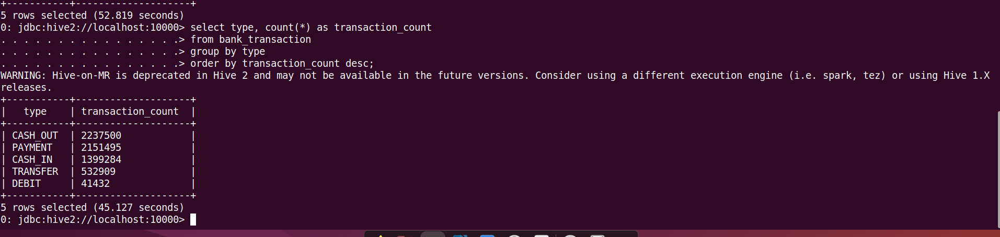
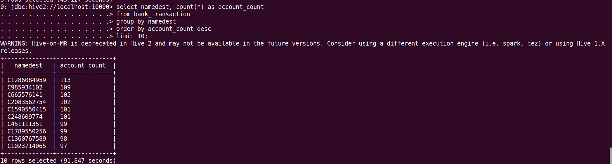
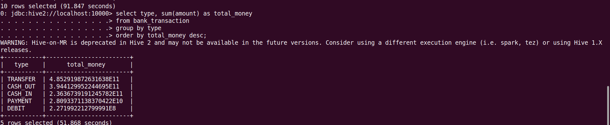
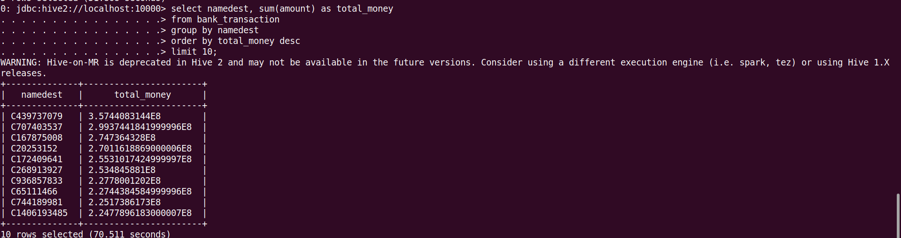
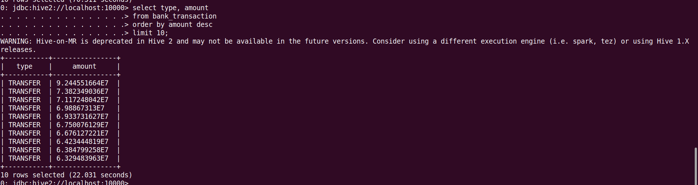
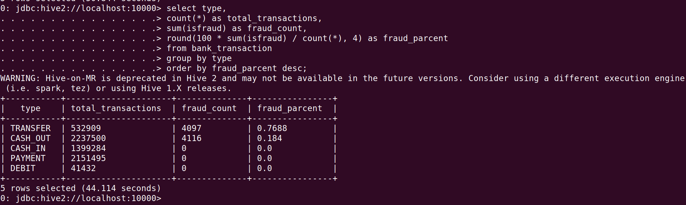
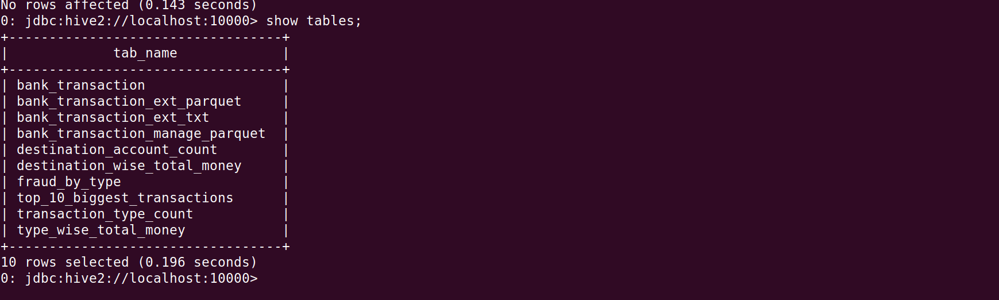
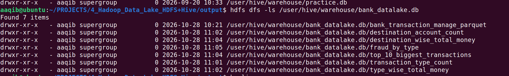

# Hadoop Data Lake Using HDFS and Hive

## 1. Project Overview
This project demonstrates a Hadoop-based data lake workflow for storing and analyzing a financial transaction dataset using **HDFS and Apache Hive**.

The pipeline starts with a CSV dataset, stores it in HDFS, manages the data through Hive tables, converts it from Text/CSV format to Parquet, performs Hive-based analysis, and saves the analysis results both as Hive tables and as Parquet outputs in HDFS.

## 2. Problem Statement
Transaction data can contain millions of records that need to be stored and analyzed efficiently.

This project demonstrates how Hadoop HDFS and Hive can be used to:

- Store transaction data in HDFS
- Create Hive external and managed tables
- Convert Text/CSV data to Parquet
- Perform analytical queries using Hive
- Save analysis results as Hive tables and as Parquet outputs in HDFS

## 3. Dataset
The project uses a simulated financial transaction dataset (mobile-money style transactions) in CSV format.

**Dataset file:**

```text
/user/aaqib/input_projects/4_hadoop_data_lake/bank_transaction.csv
```

**Size:** 6,362,620 records (about 6.36 million), excluding the header row.

Main fields:

- `step`
- `type`
- `amount`
- `nameOrig`
- `oldbalanceOrg`
- `newbalanceOrig`
- `nameDest`
- `oldbalanceDest`
- `newbalanceDest`
- `isFraud`
- `isFlaggedFraud`

Transaction types: `CASH_OUT`, `PAYMENT`, `CASH_IN`, `TRANSFER`, `DEBIT`.

## 4. Technologies Used

- Hadoop HDFS
- Apache Hive (HiveQL)
- Beeline / HiveServer2
- Linux (Ubuntu)
- CSV
- Parquet

## 5. Architecture

```text
Transaction CSV
        |
        v
       HDFS
        |
        v
Hive External Table
    (Text Format)
        |
        v
Managed Parquet Table
        |
        v
External Parquet Table (bank_transaction)
        |
        v
   Hive Analysis
        |
        +--> Hive Result Tables
        |
        +--> Parquet Outputs in HDFS
```

## 6. Data Processing
The main processing flow is:

1. Upload the transaction CSV dataset to HDFS.
2. Create the `bank_datalake` Hive database.
3. Create the external Text/CSV table `bank_transaction_ext_txt` (with `skip.header.line.count = 1` so the header row is not loaded as data).
4. Create the managed Parquet table `bank_transaction_manage_parquet`.
5. Insert the Text/CSV data into the managed Parquet table (`INSERT OVERWRITE`).
6. Create the external Parquet table `bank_transaction_ext_parquet` on top of the managed table's data.
7. Rename the external Parquet table to `bank_transaction`.
8. Run Hive analysis queries.
9. Save the results as Hive tables and as Parquet directories in HDFS.

The table creation script:

```text
hive_scripts/create_tables.hql
```

The analysis script:

```text
queries/analysis_queries.hql
```

## 7. Analysis Performed
The project performs six analyses:

1. **Transaction Type Wise Count:** counts transactions for each transaction type.
2. **Top 10 Destination Accounts by Count:** destination accounts with the most transactions.
3. **Transaction Type Wise Total Amount:** total transaction amount for each type.
4. **Top 10 Destination Accounts by Total Amount:** destination accounts with the highest total amount.
5. **Top 10 Biggest Transactions:** the 10 highest-value transactions.
6. **Fraud Analysis by Transaction Type:** total transactions, fraud count, and fraud percentage for each type.

### Analysis Screenshots

#### 1. Transaction Type Wise Count



#### 2. Top 10 Destination Accounts by Count



#### 3. Transaction Type Wise Total Amount



#### 4. Top 10 Destination Accounts by Total Amount



#### 5. Top 10 Biggest Transactions



#### 6. Fraud Analysis by Transaction Type



### Key Findings

### Key Findings

| Type | Transactions | Total amount (approx.) | Fraud cases | Fraud rate |
|---|---|---|---|---|
| TRANSFER | 532,909 | 485.3 billion | 4,097 | 0.77% |
| CASH_OUT | 2,237,500 | 394.4 billion | 4,116 | 0.18% |
| CASH_IN | 1,399,284 | 236.4 billion | 0 | 0% |
| PAYMENT | 2,151,495 | 28.1 billion | 0 | 0% |
| DEBIT | 41,432 | 0.23 billion | 0 | 0% |

- `TRANSFER` has the fewest transactions among the major types but the highest total amount.
- All 8,213 fraud cases occur only in `TRANSFER` and `CASH_OUT`.
- `TRANSFER` has the higher fraud rate (0.77%) compared to `CASH_OUT` (0.18%).

(The dataset is simulated and the currency unit is not specified, so amounts are shown as plain numbers.)

## 8. Outputs

### Hive result tables
Created in the `bank_datalake` database:

```text
destination_account_count
destination_wise_total_money
fraud_by_type
top_10_biggest_transactions
transaction_type_count
type_wise_total_money
```



### HDFS Parquet outputs
Stored under:

```text
/user/aaqib/output_projects/4_hadoop_datalake/
```

Output directories:

```text
destination_account_count/
destination_wise_total_money/
fraud_by_type/
top_10_biggest_transactions/
transaction_type_count/
type_wise_total_money/
```


Each directory contains Parquet files generated by Hive. The Parquet outputs are written from the result tables, so the heavy queries run only once.

## 9. Project Structure

```text
.
├── data_sets
│   └── bank_transactions
│       └── bank_transaction.csv
├── docs
│   ├── project_documentation.md
│   └── screenshots
├── hive_scripts
│   └── create_tables.hql
├── output
│   ├── destination_account_count
│   ├── destination_wise_total_money
│   ├── fraud_by_type
│   ├── top_10_biggest_transactions
│   ├── transaction_type_count
│   └── type_wise_total_money
├── queries
│   └── analysis_queries.hql
└── README.md
```

The `output/` folder contains local copies of the HDFS Parquet outputs.

## 10. How to Run

### Step 1: Upload the Dataset to HDFS

```bash
hdfs dfs -mkdir -p /user/aaqib/input_projects/4_hadoop_data_lake
hdfs dfs -put data_sets/bank_transactions/bank_transaction.csv /user/aaqib/input_projects/4_hadoop_data_lake
```

### Step 2: Create Hive Tables

```bash
beeline -u jdbc:hive2://localhost:10000 -n aaqib -f hive_scripts/create_tables.hql
```

### Step 3: Run Analysis Queries

```bash
beeline -u jdbc:hive2://localhost:10000 -n aaqib -f queries/analysis_queries.hql
```

Notes:

- Pass your HDFS username with `-n`. Without it, Beeline connects as `anonymous` and MapReduce jobs fail with a permission error.
- The `ALTER TABLE ... RENAME TO bank_transaction` step in `create_tables.hql` should be run only once.
- Verify the load with `SELECT COUNT(*) FROM bank_transaction;` (output: 6362620).

## 11. Challenges and Learning

### Challenges

- **Header row loaded as data:** the first count was 6,362,621 instead of 6,362,620. The CSV header was being read as a record. Fixed with `skip.header.line.count = 1` on the external table, and all downstream tables and outputs were rebuilt from clean data.
- **"Top 10" without ordering:** early queries used `LIMIT 10` without `ORDER BY`, which returns arbitrary rows. Fixed by adding `ORDER BY ... DESC`.
- **Permission error in Beeline:** running as `anonymous` caused an HDFS permission error for MapReduce. Fixed by passing the correct user with `-n`.
- **Re-runnable scripts:** added `IF NOT EXISTS`, `DROP TABLE IF EXISTS`, and `INSERT OVERWRITE` so scripts can be re-run without errors or duplicate data.

### Key Learnings

- Hadoop HDFS data storage
- Hive external vs managed tables
- Text/CSV vs Parquet storage formats
- Converting Text/CSV data to Parquet
- HiveQL aggregation, sorting, and CTAS (`CREATE TABLE AS SELECT`)
- Validating row counts to catch data quality issues
- Writing analysis results as Parquet files in HDFS

## 12. Conclusion
This project demonstrates a complete Hadoop and Hive data lake workflow for transaction data, covering HDFS storage, Hive table management, Text-to-Parquet conversion, analytical processing, fraud analysis, and Parquet-based outputs in HDFS.
